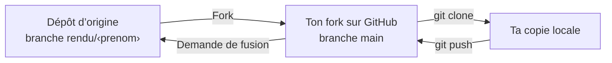

# Fork et demande de fusion sur GitHub

Tu travailles dans ton fork, une copie du dépôt sur ton compte GitHub. Tu rends ton travail par une demande de fusion (Pull Request) de la branche `main` de ton fork vers ta branche `rendu/<prenom>` du dépôt d’origine.

Le clone, les commits et le push se font avec Git, dans le terminal : voir [Commandes Git](git-commandes.md).

## Forker le dépôt

Sur la page du [dépôt d’origine](https://github.com/SIMPLON-DIST-DEVIA-P1-199833/assistant-fiches-support), cliquer sur **Fork**, choisir son compte comme **Owner**, puis cliquer sur **Create fork**.

## Ouvrir sa demande de fusion

Une fois le premier commit poussé dans le fork :

1. Sur la page du [dépôt d’origine](https://github.com/SIMPLON-DIST-DEVIA-P1-199833/assistant-fiches-support), ouvrir l’onglet **Pull requests**, puis cliquer sur **New pull request**.
2. Cliquer sur **compare across forks**, puis régler les quatre listes :
   - **base repository :** `SIMPLON-DIST-DEVIA-P1-199833/assistant-fiches-support` ;
   - **base :** `rendu/<prenom>`, ta branche ;
   - **head repository :** `<ton-compte>/assistant-fiches-support` ;
   - **compare :** `main`.
3. Vérifier que seuls tes changements apparaissent, donner un titre, puis cliquer sur **Create pull request**.

Chaque nouveau `git push` sur `main` de ton fork met à jour ta demande de fusion : inutile d’en ouvrir une autre.

## Relire la demande de fusion d’un pair

1. Dans l’onglet **Pull requests** du dépôt d’origine, ouvrir la demande de fusion du pair, puis l’onglet **Files changed**.
2. Survoler une ligne et cliquer sur l’icône **+** à côté de son numéro, écrire le commentaire, puis cliquer sur **Start a review** (ou **Add review comment** pour les suivants).
3. Cliquer sur **Review changes**, écrire un commentaire de synthèse, choisir **Comment**, puis cliquer sur **Submit review**. Les commentaires restent invisibles pour le pair jusqu’à cette étape.

## Copier le lien d’un commit

Sur la page du fork, cliquer sur **Commits**, puis sur le message du commit. Copier l’adresse de la page, de la forme `https://github.com/<ton-compte>/assistant-fiches-support/commit/<identifiant>`.
